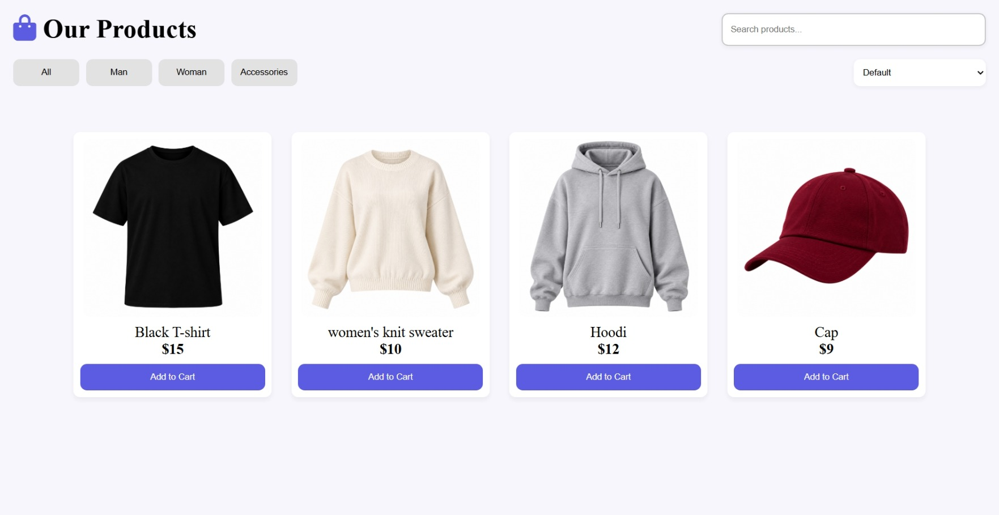

# 🛍️ Product Search & Filter

A simple and responsive Product Search & Filter application built with HTML, CSS, and JavaScript. This project allows users to search for products, filter them by category, and sort them by price.

---

## 🌟 Live Demo

[View Live Demo](https://roghayem.github.io/product-search-filter/)
👉 View Live Demo: [View Live Demo](https://roghayem.github.io/product-search-filter/)

---

## 🖼️ Preview



---

## ✨ Features

- Search products by name
- Filter products by category
- Sort products by price
- Sort prices from low to high
- Sort prices from high to low
- Dynamically display product information
- Responsive layout for different screen sizes
- Clean and user-friendly interface

---

## 🛠️ Built With

- HTML5
- CSS3
- JavaScript (ES6+)
- DOM Manipulation
- JavaScript Array Methods (`filter()`, `map()`, `sort()`)
- JavaScript Events
- CSS Flexbox
- CSS Grid
- Media Queries

---

## 🚀 Getting Started

To run this project locally:

1. Clone the repository:

   ```bash
   git clone https://github.com/roghayem/product-search-filter.git
   ```

2. Navigate to the project folder:

   ```bash
   cd product-search-filter
   ```

3. Open `index.html` in your browser.

---

## 📂 Project Structure

```text
product-search-filter/
│
├── index.html
├── style.css
├── script.js
├── assest/
│   └── product filter.jpeg
└── README.md
```

---

## 🎯 What I Learned

Through this project, I practiced:

- Working with JavaScript arrays
- Using `filter()`, `map()`, and `sort()`
- Searching and filtering data
- Manipulating the DOM
- Handling user events
- Rendering dynamic content
- Applying conditional logic
- Building responsive layouts

---

## 👩‍💻 Author

**Roghaye Mohammadi**

- GitHub: [@roghayem](https://github.com/roghayem)

---

## ⭐ Support

If you find this project useful, consider giving it a star on GitHub!
